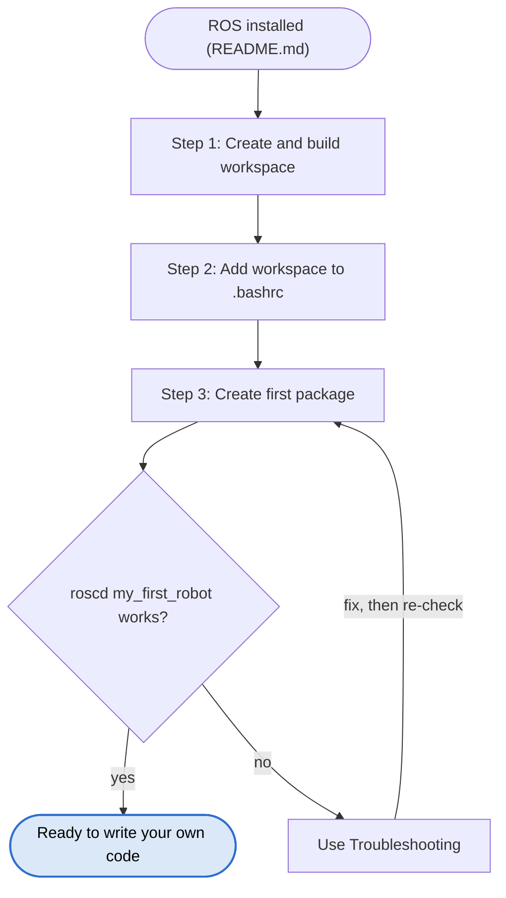

# Creating a Catkin Workspace (ROS Noetic)

_29 October 2026 · [Hemant Ramphul](https://www.linkedin.com/in/hemantramphul/)_

## Overview

This manual creates a **catkin workspace**: the folder where your own ROS programs live. Do it once, after ROS is installed and all checks in [README.md](README.md) pass.

Installing ROS does not create this folder. ROS puts its own files in `/opt/ros/noetic`; you make the workspace yourself. By tradition it is called `catkin_ws`, but any name works.

| Folder | Made by | Holds |
| --- | --- | --- |
| `/opt/ros/noetic` | ROS installation | ROS itself; do not edit |
| `~/catkin_ws` | You | Your own packages |

`catkin_make` is the build command for ROS 1 and is already installed with ROS. It prepares your code so ROS can find and run it.



## Step 1: Create and build the workspace

```bash
mkdir -p ~/catkin_ws/src
cd ~/catkin_ws
catkin_make
```

On this first run, `catkin_make` adds `build` and `devel` next to `src`:

```
~/catkin_ws/
├── src/     ← your code goes here (you edit this)
├── build/   ← made by catkin_make (do not edit)
└── devel/   ← made by catkin_make (do not edit)
```

**Check:** `ls ~/catkin_ws` shows `build`, `devel` and `src`.

## Step 2: Add the workspace to every terminal

New terminals must know the workspace exists. Add the line only if it is not already there; it must come after the `/opt/ros/noetic` line from README Step 4, which it does when appended:

```bash
grep -q '^source ~/catkin_ws/devel/setup.bash' ~/.bashrc || echo "source ~/catkin_ws/devel/setup.bash" >> ~/.bashrc
```

Close the terminal and open a new one.

**Check:** `echo $ROS_PACKAGE_PATH` includes `/home/<user>/catkin_ws/src`.

## Step 3: Create your first package

A **package** is one project folder inside `src`. This one uses Python (`rospy`) and basic message types (`std_msgs`):

```bash
cd ~/catkin_ws/src
catkin_create_pkg my_first_robot rospy std_msgs
cd ~/catkin_ws
catkin_make
```

**Check:** in a new terminal, `roscd my_first_robot` moves you into `~/catkin_ws/src/my_first_robot`.

If it says `roscd: No such package/stack 'my_first_robot'`, check in this order:

1. `ls ~/catkin_ws/src` shows `my_first_robot`; if not, run the `catkin_create_pkg` command above.
2. `catkin_make` was run in `~/catkin_ws` after creating the package, and ended without errors.
3. `source ~/catkin_ws/devel/setup.bash`, then try `roscd` again. If it works now, the `.bashrc` line from Step 2 is missing; add it.

Being inside `~/catkin_ws/src` does not help: `roscd` only looks where ROS has been told the workspace is.

## Daily routine

1. Write or change code in `~/catkin_ws/src/<package>`.
2. Build: `cd ~/catkin_ws && catkin_make` (always from `~/catkin_ws`, never from inside `src`).
3. Open a new terminal so it picks up the new build.
4. Start `roscore`, then your program: `rosrun <package> <program>`.

Python programs need no compiling, but the build still registers new packages and custom messages.

`catkin build` (package `python3-catkin-tools`) is an alternative to `catkin_make`. Use one or the other in a workspace, never both.

## Next step

Your package exists but is still empty. Continue with [MY_FIRST_ROBOT.md](MY_FIRST_ROBOT.md) to write your first programs and drive the turtle with them.

## Troubleshooting

| Symptom | Cause | Fix |
| --- | --- | --- |
| `catkin_make: command not found` | ROS not sourced in this terminal | Check README Step 4, open a new terminal |
| `~/catkin_ws/devel/setup.bash: No such file or directory` | `catkin_make` never ran in the workspace | `cd ~/catkin_ws && catkin_make` |
| `roscd: No such package/stack '<name>'` | Package not created, workspace not built, or terminal not sourced | Follow the three checks under Step 3 |
| `rosrun` or `roscd`: package not found | Workspace not built or terminal not refreshed | `catkin_make` in `~/catkin_ws`, then open a new terminal |
| `catkin_make` errors about `CMakeLists.txt` in `src` | Run from inside `src` instead of the workspace top | `cd ~/catkin_ws`, then `catkin_make` |
| `catkin_make` complains the workspace was built with `catkin build` | Both tools used in one workspace | Delete `build` and `devel`, then use only one tool |

## Quick reference

| Command | What it does |
| --- | --- |
| `cd ~/catkin_ws && catkin_make` | Builds your own packages |
| `catkin_create_pkg <name> rospy std_msgs` | Creates a new package (run inside `src`) |
| `roscd <package>` | Jumps into a package's folder |
| `rosrun <package> <program>` | Starts one of your programs |
| `echo $ROS_PACKAGE_PATH` | Shows where ROS looks for packages |

## Sources

- [Installing and configuring your ROS environment (ROS Wiki)](https://wiki.ros.org/ROS/Tutorials/InstallingandConfiguringROSEnvironment)
- [Creating a ROS package (ROS Wiki)](https://wiki.ros.org/ROS/Tutorials/CreatingPackage)
