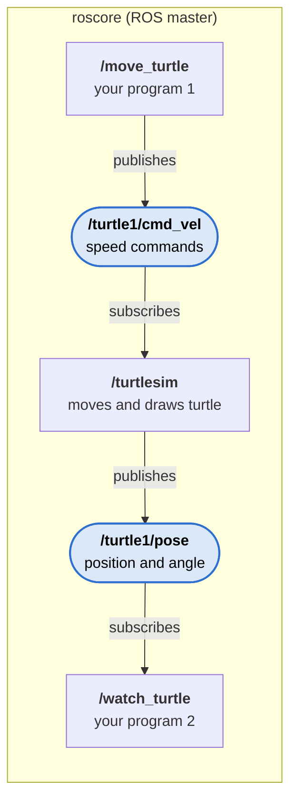

# My First Robot Program (ROS Noetic)

_29 October 2026 · [Hemant Ramphul](https://www.linkedin.com/in/hemantramphul/)_

## Overview

This manual writes two small Python programs in the `my_first_robot` package and runs them with turtlesim. Do it after [CATKIN_WORKSPACE.md](CATKIN_WORKSPACE.md), when `roscd my_first_robot` works.

| Program | Job | Topic |
| --- | --- | --- |
| `move_turtle.py` | Drives the turtle in a circle | Publishes `/turtle1/cmd_vel` |
| `watch_turtle.py` | Prints where the turtle is | Subscribes to `/turtle1/pose` |

It is the same idea as the turtlesim check in [README.md](README.md), but now your own code replaces the arrow keys and `rostopic echo`.

## Before you start

Check that ROS can find your package:

```bash
roscd my_first_robot
```

If it says `roscd: No such package/stack 'my_first_robot'`, fix it in this order and stop as soon as `roscd` works. Being inside `~/catkin_ws/src` does not help: `roscd` only looks where ROS has been told the workspace is.

1. **Does the package exist?** `ls ~/catkin_ws/src` must show `my_first_robot`. If not, create it:

   ```bash
   cd ~/catkin_ws/src
   catkin_create_pkg my_first_robot rospy std_msgs
   ```

2. **Is the workspace built?** Run `cd ~/catkin_ws && catkin_make`. It must end without red errors, and `ls ~/catkin_ws` must show `build`, `devel` and `src`.

3. **Does this terminal know the workspace?** Run `source ~/catkin_ws/devel/setup.bash`, then `roscd my_first_robot` again. If it works now, make it permanent for every new terminal:

   ```bash
   grep -q '^source ~/catkin_ws/devel/setup.bash' ~/.bashrc || echo "source ~/catkin_ws/devel/setup.bash" >> ~/.bashrc
   ```

**Check:** `roscd my_first_robot` moves you into `~/catkin_ws/src/my_first_robot`.



_Rectangles are nodes (running programs); rounded blue shapes are topics (named message channels)._

At the end, the package looks like this:

```
~/catkin_ws/src/my_first_robot/
├── CMakeLists.txt
├── package.xml
├── scripts/
│   ├── move_turtle.py
│   └── watch_turtle.py
└── launch/
    └── turtle_circle.launch
```

## Step 1: Add the message packages

The programs use speed messages from `geometry_msgs` and position messages from `turtlesim`. Tell the package about them: open `package.xml`

```bash
gedit ~/catkin_ws/src/my_first_robot/package.xml
```

and add these two lines next to the existing `<depend>` lines (if your file has `<build_depend>`/`<exec_depend>` lines instead, add them there with the same names):

```xml
<depend>geometry_msgs</depend>
<depend>turtlesim</depend>
```

Both packages are already installed with `ros-noetic-desktop-full`.

## Step 2: Write the driving program

```bash
mkdir -p ~/catkin_ws/src/my_first_robot/scripts
gedit ~/catkin_ws/src/my_first_robot/scripts/move_turtle.py
```

Paste this, then save:

```python
#!/usr/bin/env python3
"""Drive the turtlesim turtle in a circle.

Publishes speed commands on /turtle1/cmd_vel, 10 times per second.
"""
import rospy
from geometry_msgs.msg import Twist


def main():
    rospy.init_node("move_turtle")
    pub = rospy.Publisher("/turtle1/cmd_vel", Twist, queue_size=10)
    rate = rospy.Rate(10)  # 10 messages per second

    cmd = Twist()
    cmd.linear.x = 2.0   # forward speed
    cmd.angular.z = 1.0  # turning speed (makes it a circle)

    rospy.loginfo("Driving the turtle in a circle. Press Ctrl+C to stop.")
    while not rospy.is_shutdown():
        pub.publish(cmd)
        rate.sleep()


if __name__ == "__main__":
    try:
        main()
    except rospy.ROSInterruptException:
        pass
```

What it does, line by line:

| Code | Meaning |
| --- | --- |
| `#!/usr/bin/env python3` | Run this file with Python 3 (must be the first line) |
| `rospy.init_node("move_turtle")` | Register with `roscore` under the name `/move_turtle` |
| `rospy.Publisher("/turtle1/cmd_vel", Twist, ...)` | Prepare to send speed messages on that topic |
| `cmd.linear.x` / `cmd.angular.z` | Forward speed / turning speed |
| `pub.publish(cmd)` + `rate.sleep()` | Send the command, wait, repeat 10 times a second |

## Step 3: Write the watching program

```bash
gedit ~/catkin_ws/src/my_first_robot/scripts/watch_turtle.py
```

Paste this, then save:

```python
#!/usr/bin/env python3
"""Print where the turtlesim turtle is.

Listens on /turtle1/pose and prints the position once per second.
"""
import rospy
from turtlesim.msg import Pose


def on_pose(pose):
    # Called every time a new position arrives (about 60 times per second).
    # loginfo_throttle prints at most once per second so the screen stays readable.
    rospy.loginfo_throttle(1, "x=%.2f  y=%.2f  angle=%.2f" % (pose.x, pose.y, pose.theta))


def main():
    rospy.init_node("watch_turtle")
    rospy.Subscriber("/turtle1/pose", Pose, on_pose)
    rospy.loginfo("Watching the turtle. Press Ctrl+C to stop.")
    rospy.spin()  # keep running and wait for messages


if __name__ == "__main__":
    main()
```

`rospy.Subscriber` says "call `on_pose` each time a message arrives on `/turtle1/pose`", and `rospy.spin()` keeps the program alive waiting for them.

## Step 4: Make the programs runnable and build

```bash
chmod +x ~/catkin_ws/src/my_first_robot/scripts/*.py
cd ~/catkin_ws
catkin_make
```

`chmod +x` marks the files as programs; without it, `rosrun` cannot find them. Open a new terminal afterwards.

## Step 5: Run it

Use Terminator with four panes (Ctrl+Shift+E side by side, Ctrl+Shift+O one above the other), in local mode.

| Pane | Command | You see |
| --- | --- | --- |
| 1 | `roscore` | `started core service [/rosout]` |
| 2 | `rosrun turtlesim turtlesim_node` | The blue turtle window |
| 3 | `rosrun my_first_robot move_turtle.py` | The turtle drives in a circle |
| 4 | `rosrun my_first_robot watch_turtle.py` | A line like `x=6.12  y=7.48  angle=1.05` every second |

**Check:** `rosnode list` shows `/move_turtle` and `/watch_turtle`, and `rqt_graph` draws them connected to `/turtlesim` as in the diagram above.

Stop each program with Ctrl+C. Try changing `cmd.linear.x` or `cmd.angular.z`, save, and run `move_turtle.py` again: Python changes need no rebuild.

## Step 6: Start everything at once with a launch file

Typing four commands every time gets slow. A **launch file** starts several nodes together, and `roslaunch` also starts `roscore` if it is not running.

```bash
mkdir -p ~/catkin_ws/src/my_first_robot/launch
gedit ~/catkin_ws/src/my_first_robot/launch/turtle_circle.launch
```

Paste this, then save:

```xml
<launch>
  <!-- The turtle window -->
  <node pkg="turtlesim" type="turtlesim_node" name="turtlesim"/>

  <!-- Our two programs from my_first_robot -->
  <node pkg="my_first_robot" type="move_turtle.py" name="move_turtle" output="screen"/>
  <node pkg="my_first_robot" type="watch_turtle.py" name="watch_turtle" output="screen"/>
</launch>
```

Run it:

```bash
roslaunch my_first_robot turtle_circle.launch
```

**Check:** the turtle window opens, the turtle drives in a circle, and the positions print in the same terminal. Ctrl+C stops everything.

## Troubleshooting

| Symptom | Cause | Fix |
| --- | --- | --- |
| `roscd: No such package/stack 'my_first_robot'` | Package not created, workspace not built, or terminal not sourced | Follow Before you start, checks 1 to 3 |
| `Couldn't find executable named move_turtle.py` | File not marked as a program | `chmod +x` (Step 4) |
| `[rospack] Error: package 'my_first_robot' not found` | Workspace not built or terminal not refreshed | `catkin_make` in `~/catkin_ws`, then open a new terminal |
| `Unable to register with master node` | `roscore` not running, or robot mode set | Start `roscore`; use local mode (README Step 4) |
| Program runs but the turtle does not move | turtlesim not running, or topic name typed wrong | Start `turtlesim_node`; check `rostopic list` shows `/turtle1/cmd_vel` |
| `/usr/bin/env: 'python3\r': No such file or directory` | File saved with Windows line endings | `sed -i 's/\r$//' ~/catkin_ws/src/my_first_robot/scripts/*.py` |
| `ModuleNotFoundError: No module named 'rospy'` | Run with `python3 file.py` in a terminal without ROS | Use `rosrun`, and check README Step 4 |

## Quick reference

| Command | What it does |
| --- | --- |
| `rosrun my_first_robot move_turtle.py` | Drives the turtle in a circle |
| `rosrun my_first_robot watch_turtle.py` | Prints the turtle's position |
| `roslaunch my_first_robot turtle_circle.launch` | Starts turtlesim and both programs |
| `chmod +x <file>.py` | Makes a Python file runnable by `rosrun` |
| `rostopic info /turtle1/cmd_vel` | Shows who publishes and who listens on a topic |

## Sources

- [Writing a simple publisher and subscriber in Python (ROS Wiki)](https://wiki.ros.org/ROS/Tutorials/WritingPublisherSubscriber%28python%29)
- [Using roslaunch (ROS Wiki)](https://wiki.ros.org/ROS/Tutorials/UsingRqtconsoleRoslaunch)
- [turtlesim package (ROS Wiki)](https://wiki.ros.org/turtlesim)
