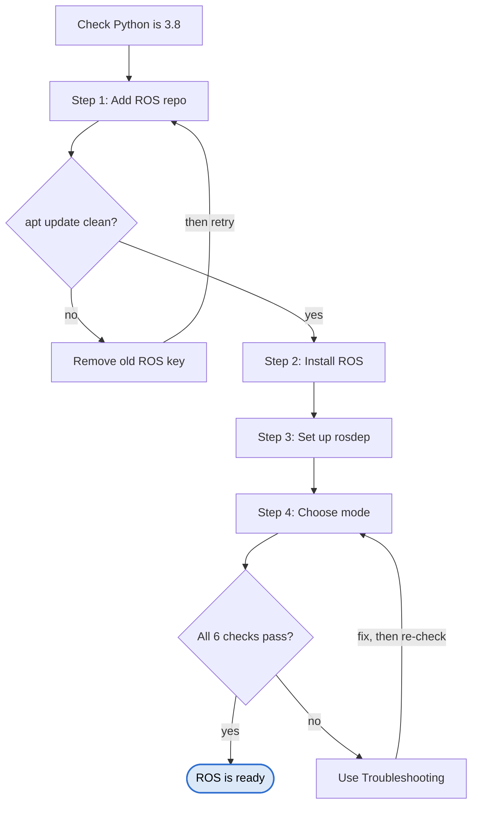
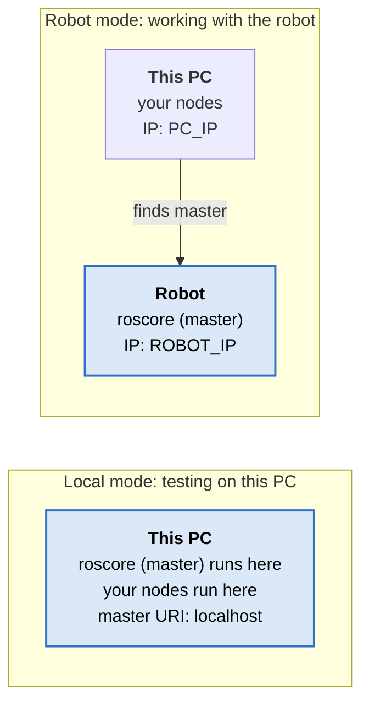
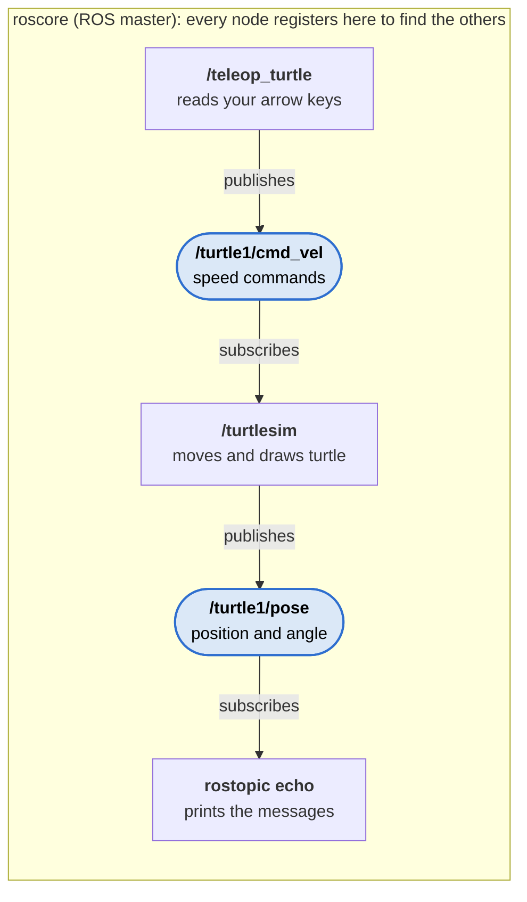

# ROS Noetic Installation Manual (Ubuntu 20.04)

_28 October 2026 · Hemant Ramphul_

## Overview

This manual installs ROS Noetic (ROS 1) on Ubuntu 20.04 and checks that it works. It uses the newer `ros-apt-source` key method, because the old ROS signing key expired on 1 June 2025 and the old wiki commands no longer work.

| Item | Required |
| --- | --- |
| Operating system | Ubuntu 20.04 LTS (focal) |
| Python | 3.8 as the system default (`python3 --version` → 3.8.x) |
| Disk space | About 5 GB free for desktop-full |
| Network | Internet connection; a user account with `sudo` |

Run every command in a terminal (Terminal, XFCE Terminal or Terminator). Commands go in one at a time unless shown as a group.



A failed check never moves you forward: an unclean `apt update` sends you back to remove the old key, and a failed verification sends you to Troubleshooting.

## Before you start

Check that Ubuntu's default Python is 3.8. Ubuntu 20.04's own tools and ROS Noetic both depend on it; another version breaks Terminal, `lsb_release` and ROS.

```bash
python3 --version
```

If it shows anything other than 3.8.x, set it back:

```bash
sudo ln -sf /usr/bin/python3.8 /usr/bin/python3
```

Remove any old ROS repository files and the expired key, so they do not clash with the new setup:

```bash
sudo rm -f /etc/apt/sources.list.d/ros-latest.list* /etc/apt/sources.list.d/ros1-latest.list*
sudo apt-key del "C1CF 6E31 E6BA DE88 68B1  72B4 F42E D6FB AB17 C654"
```

It is fine if these report that nothing was found.

## Step 1: Add the ROS repository

Install the official `ros-apt-source` package. It adds both the ROS repository and its signing key, and keeps the key updated through normal `apt` updates.

```bash
sudo apt install curl
export ROS_APT_SOURCE_VERSION=$(curl -s https://api.github.com/repos/ros-infrastructure/ros-apt-source/releases/latest | grep -F "tag_name" | awk -F\" '{print $4}')
curl -L -o /tmp/ros-apt-source.deb "https://github.com/ros-infrastructure/ros-apt-source/releases/download/${ROS_APT_SOURCE_VERSION}/ros-apt-source_${ROS_APT_SOURCE_VERSION}.focal_all.deb"
sudo apt install /tmp/ros-apt-source.deb
sudo apt update
```

**Check:** `sudo apt update` lists `packages.ros.org` with no `EXPKEYSIG` error.

Do not also run the wiki's "Setup your sources.list" and "Set up your keys" steps. That would list the ROS repository twice with different keys.

## Step 2: Install ROS Noetic

Install the full desktop version. It includes RViz, rqt, Gazebo and the turtlesim test tools, and downloads a few GB.

```bash
sudo apt install ros-noetic-desktop-full
```

| Package | Contents | When to choose |
| --- | --- | --- |
| `ros-noetic-desktop-full` | Desktop + simulators + perception | Development PC (recommended) |
| `ros-noetic-desktop` | ROS-Base + rqt, RViz | Lighter PC with a GUI |
| `ros-noetic-ros-base` | Core libraries only, no GUI tools | Robot onboard computer or server |

Extra packages follow the pattern `sudo apt install ros-noetic-<name>`; `apt search ros-noetic` lists them.

## Step 3: Install build tools and rosdep

These tools build your own ROS packages and install their dependencies.

```bash
sudo apt install python3-rosdep python3-rosinstall python3-rosinstall-generator python3-wstool build-essential
sudo rosdep init
rosdep update
```

Run `rosdep update` without `sudo`. **Check:** it ends with `updated cache in /home/<user>/.ros/rosdep/sources.cache`.

If `rosdep init` says the default sources list already exists, it was initialised before; skip to `rosdep update`.

## Step 4: Set up the environment

ROS settings live in `~/.bashrc`, a hidden file in your home folder that runs each time a terminal opens. Add the ROS line only if it is not already there:

```bash
grep -q '^source /opt/ros/noetic/setup.bash' ~/.bashrc || echo "source /opt/ros/noetic/setup.bash" >> ~/.bashrc
```

Edit the file with `gedit ~/.bashrc` (or `nano ~/.bashrc`). A `#` at the start of a line switches it off. Choose one mode:



In local mode everything runs on this PC; in robot mode your PC's nodes connect over the network to the master on the robot.

**Local mode** — ROS runs on this PC only (testing):

```bash
# export ROS_IP=<PC_IP>
# export ROS_HOSTNAME=$ROS_IP
# export ROS_MASTER_URI=http://<ROBOT_IP>:11311
export ROS_MASTER_URI=http://localhost:11311
```

**Robot mode** — this PC is the hotspot or on the robot's network, and the robot runs the ROS master. Replace PC_IP with this PC's IP address and ROBOT_IP with the robot's; run `hostname -I` on each machine to find them. Example: when this PC shares a hotspot, it is often 10.42.0.1 and the robot something like 10.42.0.56.

```bash
export ROS_IP=<PC_IP>
export ROS_HOSTNAME=$ROS_IP
export ROS_MASTER_URI=http://<ROBOT_IP>:11311
#export ROS_MASTER_URI=http://localhost:11311
```

After saving, close all terminals and open new ones; an open terminal keeps its old values. **Check:** `echo $ROS_MASTER_URI` shows the address for the mode you chose.

## Verify the installation

ROS is correctly installed when all six checks below pass. Use local mode, and Terminator split into panes (Ctrl+Shift+E side by side, Ctrl+Shift+O one above the other).

- [ ] **Version:** `rosversion -d` prints `noetic`.
- [ ] **Packages:** `ls /opt/ros` shows `noetic`.
- [ ] **ROS core:** `roscore` prints `started core service [/rosout]` within a few seconds and keeps running. Leave it open.
- [ ] **Turtlesim:** in a second pane, `rosrun turtlesim turtlesim_node` opens a blue window with a turtle. In a third pane, `rosrun turtlesim turtle_teleop_key`; click that pane and use the arrow keys — the turtle moves.
- [ ] **Nodes and topics:** in another pane, `rosnode list` shows `/rosout`, `/teleop_turtle`, `/turtlesim`; `rostopic list` shows `/turtle1/cmd_vel` and `/turtle1/pose`; `rostopic echo /turtle1/pose` streams the position as you drive.
- [ ] **Messaging:** `rosrun rospy_tutorials talker` in one pane and `rosrun rospy_tutorials listener` in another; the listener prints the "hello world" messages.

A **node** is a running ROS program; a **topic** is a named channel nodes use to send and receive messages. `rqt_graph` draws them connected. Stop everything with Ctrl+C in each pane.



_Rectangles are nodes (running programs); rounded blue shapes are topics (named message channels)._

Your arrow keys travel from `/teleop_turtle` onto `/turtle1/cmd_vel`, which `/turtlesim` reads; `rostopic echo` listens on `/turtle1/pose` the same way.

## Troubleshooting

| Symptom | Cause | Fix |
| --- | --- | --- |
| `EXPKEYSIG F42ED6FBAB17C654` on `apt update` | Old ROS key, expired 1 June 2025 | Remove old ROS list files and key (Before you start), then Step 1 |
| `roscore` hangs or cannot reach the master | `ROS_MASTER_URI` points to the robot's IP | Switch to local mode (Step 4), open a new terminal |
| `/opt/ros/noetic/setup.bash: No such file or directory` | `.bashrc` sources ROS but ROS is not installed | Install ROS, or put `#` before that line |
| Terminal will not open; `cannot import name '_gi'` | Default `python3` is not 3.8 | `sudo ln -sf /usr/bin/python3.8 /usr/bin/python3` |
| `echo $ROS_MASTER_URI` still shows the old value | Terminal opened before the edit | Close it and open a new terminal |
| `rosdep init`: default sources list already exists | Initialised earlier | Skip to `rosdep update` |
| `apt update` warns the ROS repo is configured twice | Wiki sources step run as well as Step 1 | `sudo rm /etc/apt/sources.list.d/ros-latest.list*` |

## Quick reference

| Command | What it does |
| --- | --- |
| `rosversion -d` | Shows the installed ROS version |
| `roscore` | Starts the ROS master (keep it running) |
| `rosrun <package> <node>` | Starts one node |
| `roslaunch <package> <file>.launch` | Starts several nodes from a launch file |
| `rosnode list` / `rosnode info <node>` | Lists running nodes / shows what one sends and receives |
| `rostopic list` / `rostopic echo <topic>` | Lists topics / prints live messages on one |
| `rqt_graph` | Draws nodes and topics connected |
| `echo $ROS_MASTER_URI` | Shows which master ROS will use |
| `gedit ~/.bashrc` | Edits ROS settings (local or robot mode) |

## Sources

- [ROS signing key migration guide (Open Robotics Discourse)](https://discourse.openrobotics.org/t/ros-signing-key-migration-guide/43937)
- [ROS Noetic installation on Ubuntu (ROS Wiki)](https://wiki.ros.org/noetic/Installation/Ubuntu)
